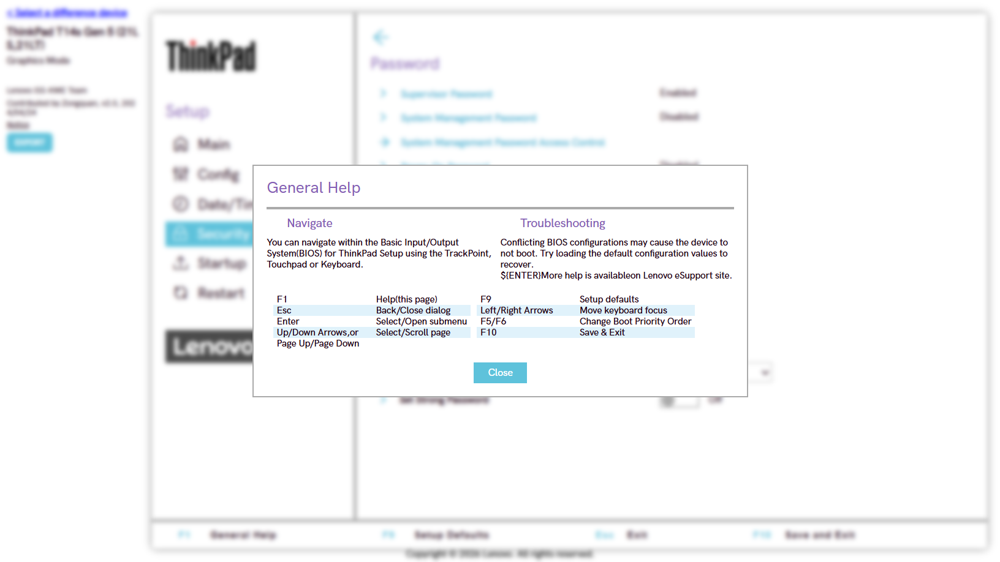
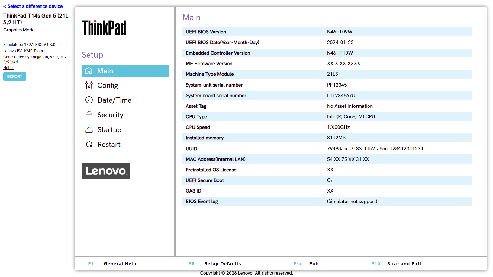
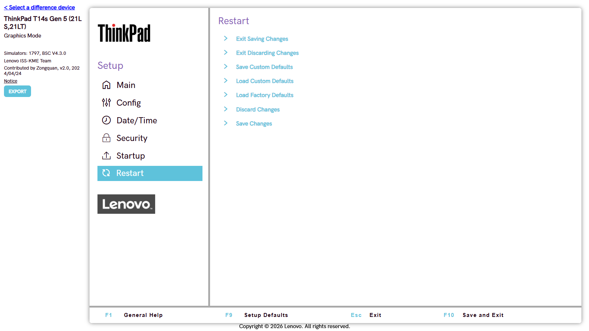
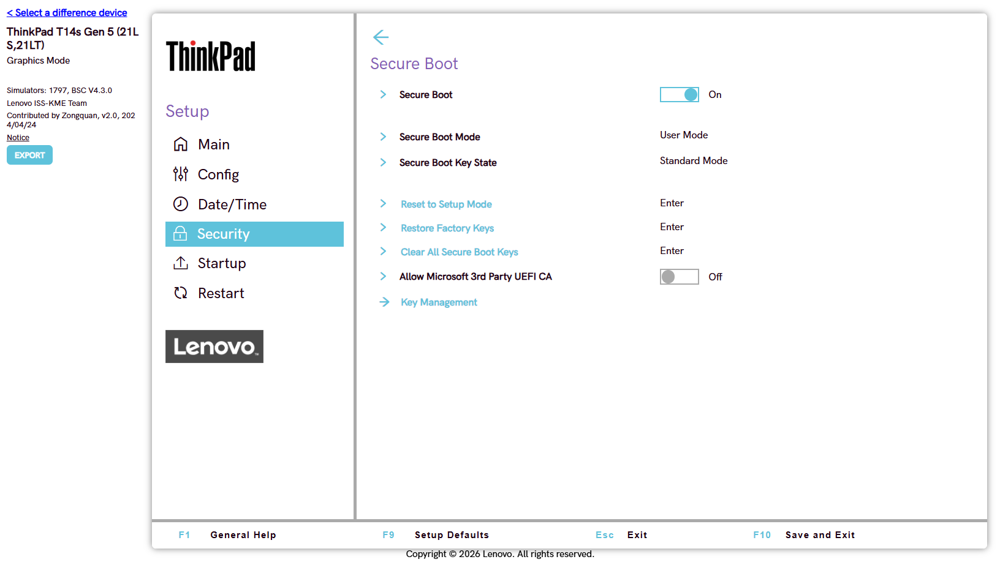
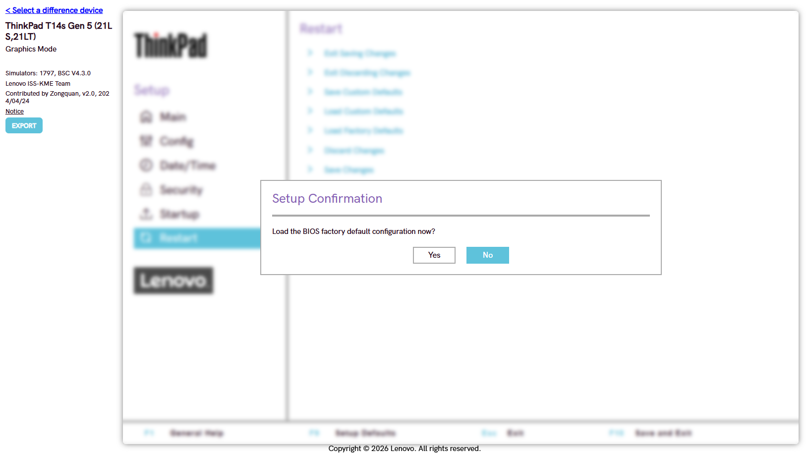
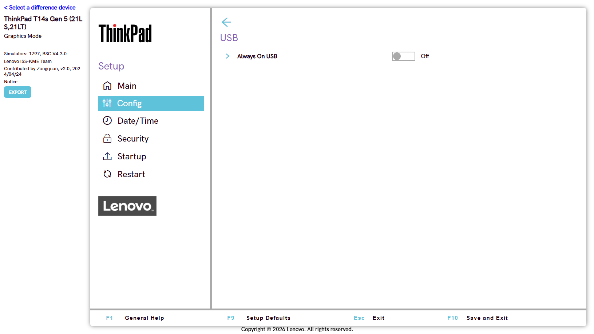
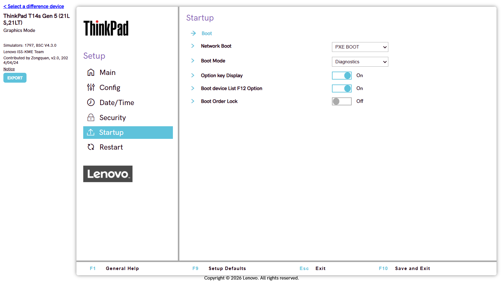
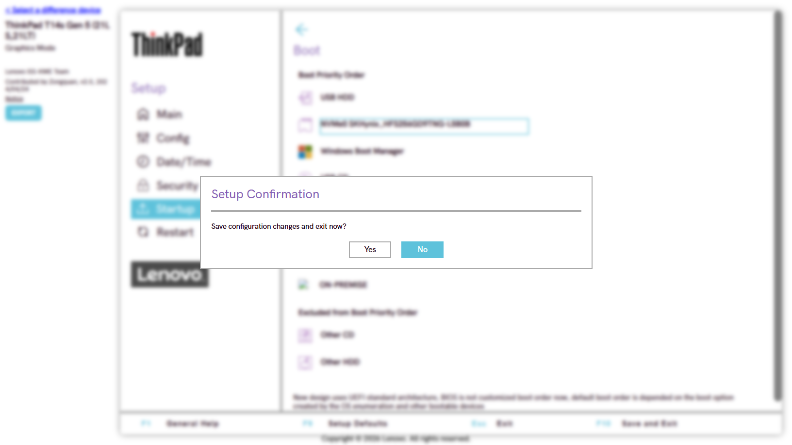
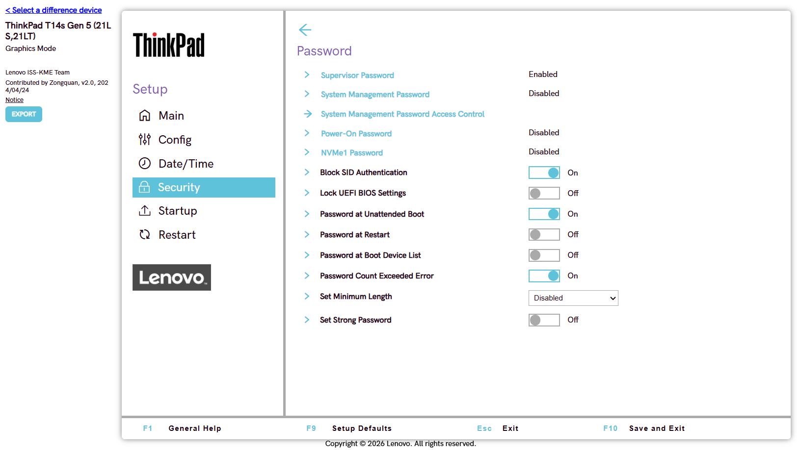

# BIOS/UEFI, Lenovo BIOS Simulator

Сайт: https://download.lenovo.com/bsco/index.html

Взял ThinkPad T14s Gen 5 (21LS, 21LT), Graphics Interface Mode.

Справка по клавишам на F1. F9 сбрасывает настройки, F10 сохраняет и выходит, Esc назад, Enter открывает пункт. F5/F6 в справке написаны для смены порядка загрузки, в графическом режиме у меня сработал перетаскиванием.

## Задача 1

Слева меню: Main, Config, Date/Time, Security, Startup, Restart.

В Main всё про саму машину, менять там нечего.

Что просили выписать:

- серийный номер: PF12345 (платы отдельно L112345678)
- версия UEFI: N46ET09W, дата 2024-01-22
- CPU: Intel Core, частота в симуляторе написана как 1.X00GHz

Ещё там 8 ГБ памяти, Secure Boot уже On, а BIOS Event log написан как Simulator not support.

Config это железо: сеть, USB, клавиатура, экран, питание, звук, процессор, Thunderbolt, AMT.

Security это пароли, Secure Boot и всё, что закрывает машину.

Startup это загрузка.

Restart это выход и сброс.

Куда потом ходить: порядок загрузки в Startup, Secure Boot и пароль в Security, сброс в Restart.

## Задача 2

Startup -> Boot.

Сначала так:

1. Windows Boot Manager
2. USB CD
3. USB FDD
4. NVMe0 SKHynix_HFS256GD9TNG-L5B0B
5. USB HDD
6. PXE BOOT
7. LENOVO CLOUD
8. ON-PREMISE

Other CD и Other HDD лежат ниже, в Excluded, из них система не грузится.

F5 и F6 из справки список не двигали. В графическом режиме пункты просто перетаскиваются. USB у меня это USB HDD, флешка. Её поставил первой, диск NVMe второй.

1. USB HDD
2. NVMe0
3. Windows Boot Manager
4. USB CD
5. USB FDD
6. дальше сеть и облако

Пока из Setup не выходишь, этот порядок на месте. Записать его надо F10.

## Задача 3

Security -> Secure Boot. Стояло On, режим User Mode, ключи Standard Mode.

Выключил, потом включил обратно. Окна про перезагрузку не было, галка меняется сразу.

Secure Boot при включении проверяет, подписан ли загрузчик. Если подписи нет, система не стартует. Из-за этого сложнее подсунуть свою загрузку с флешки. Выключают, когда ставят систему, которую эта проверка не пускает.

На живом ноутбуке это начинает работать после F10 и перезагрузки. Здесь симулятор просто переключил пункт.

## Задача 4

Security -> Password -> Supervisor Password. Было Disabled. Вписал Test1234 два раза и Save.

Стало Enabled.

Потом попробовал поменять Set Strong Password. По заданию должен был спросить пароль. Не спросил, пункт просто стал On.

Снять пароль в этом же окне тоже не вышло. Пустые поля он не берёт, старый пароль вводить некуда. На обычном ThinkPad пароль снимают так: вводишь текущий и новый оставляешь пустым. Здесь так нельзя. Снялся он только после заводского сброса, статус снова Disabled. На настоящей машине сброс настроек пароль супервизора как раз не убирает.

## Задача 5

Restart -> Load Factory Defaults. То же самое F9, в справке это Setup Defaults.

Спрашивает: Load the BIOS factory default configuration now?

Нажал Yes. Страница симулятора перезагрузилась, всё встало как в начале.

В подсказке к пункту написано, что Security и дату он не сбрасывает. У меня сбросилось и это тоже: пароль опять Disabled, порядок загрузки опять с Windows Boot Manager, Secure Boot On, Boot Mode Quick, Always On USB On.

## Задача 6

USB BIOS Support у этой модели нет. Есть Config -> USB -> Always On USB.

Это питание USB, когда ноутбук выключен или спит и зарядка воткнута. On порты питают телефон, Off нет.

Было On. Выключил и включил обратно.

Когда Always On USB выключен, пропадает Charge in Battery Mode. Этот второй пункт про зарядку уже от батареи, без него он не нужен.

Путь: Config -> USB -> Always On USB.

## Задача 7

Config -> Storage и SATA Controller Mode тут нет. В Config нет пункта про диски вообще. Диск виден только в загрузке: NVMe0 SKHynix_HFS256GD9TNG-L5B0B. Переключать AHCI / RAID / Intel RST некуда, предупреждения тоже не выскочило. У T14s Gen 5 обычного SATA-диска нет, стоит NVMe.

Если на другой машине такой пункт есть, режимы примерно такие. AHCI это нормальный режим, диски видны по отдельности, Windows и Linux ставятся без лишнего драйвера. RAID и Intel RST нужны, когда диски собраны в массив или есть кэш Intel. Без драйвера RST установщик диск часто не видит. На новых платах похожая история с Intel VMD: NVMe прячется за контроллером, и пока не подложить драйвер, диска в установщике нет.

Если поменять режим на уже стоящей системе, она может не найти свой диск и не загрузиться. Перед этим лучше иметь копию.

## Задача 8

Постоянный порядок это Startup -> Boot, он записывается.

Отдельно есть Startup -> Boot device List F12 Option. Сейчас On. Если он включён, при старте F12 показывает список устройств на один раз. Что выбрал, то и грузится, записанный порядок не меняется.

Boot Mode рядом: Quick или Diagnostics. Quick не показывает проверку при старте, пока не нажмёшь Esc. Diagnostics показывает её всегда. Поставил Diagnostics, потом вернул Quick.

Для установки с флешки обычно хватает F12 на один раз. Порядок в Boot трогать не обязательно.

## Задача 9

В Main внизу BIOS Event log, там написано Simulator not support. Config -> Diagnostics нет. Clear Event Log нет. Открыть лог и очистить его в симуляторе нельзя.

На обычном ThinkPad этот журнал в Main или отдельным пунктом BIOS Event Log. Ошибки самопроверки, память, кривые загрузки пишутся туда. Чистится там же, пункт Clear Event Log.

Экран Main есть в задаче 1.

## Задача 10

После сброса прошёл сценарий заново.

1. Restart -> Load Factory Defaults -> Yes. Всё заводское.
2. Secure Boot уже On, оставил так. Для обычной Windows он нужен включённым.
3. Пароль супервизора Test1234, стало Enabled.
4. В Boot поставил USB HDD первым, NVMe вторым. Снимок в задаче 2.
5. F10. Спросило Save configuration changes and exit now?

Yes здесь не сохраняет настройки в ноутбук. Симулятор предлагает файл с изменениями и выкидывает к выбору устройства. Если зайти в него снова, будет снова заводское. Поэтому проверял, не нажимая Yes.

6. Ещё раз открыл Security -> Password, пароль всё ещё Enabled. Порядок загрузки тоже остался USB HDD, потом NVMe.

Потом снова Load Factory Defaults. Пароль стал Disabled, первым в загрузке опять Windows Boot Manager. Снимки в задаче 5.

Отдельным действием пароль не снимается и порядок сам не откатывается. В симуляторе это делает только общий сброс.
