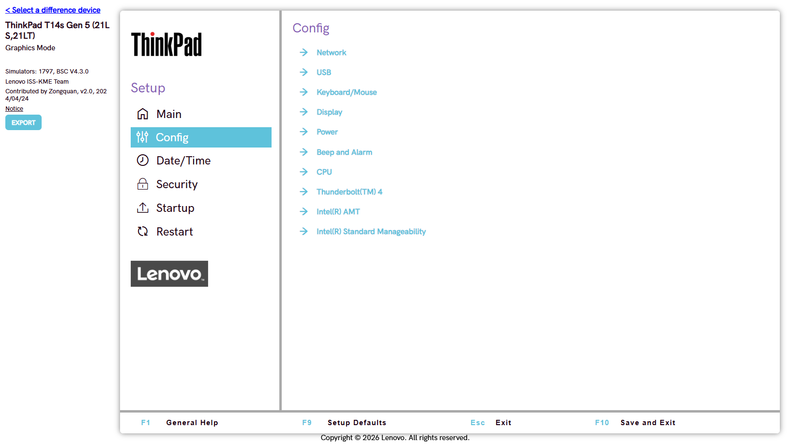
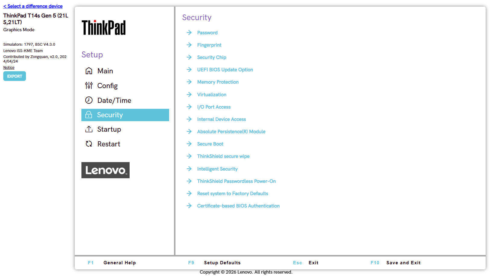
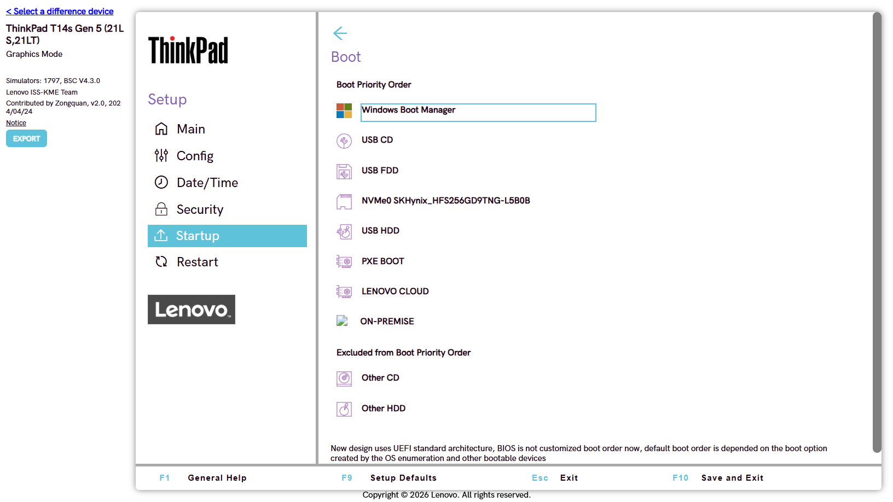
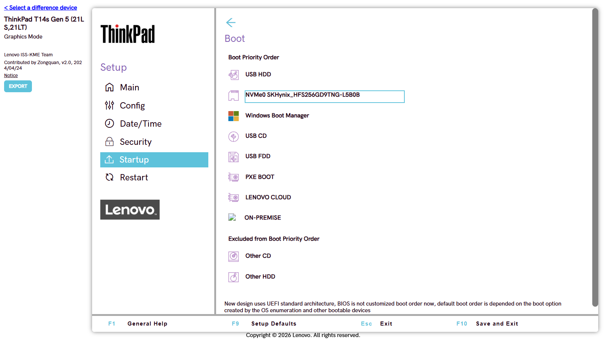
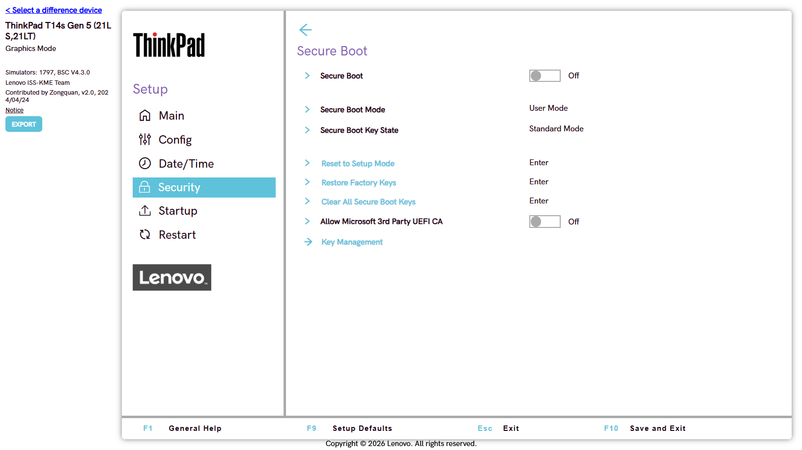
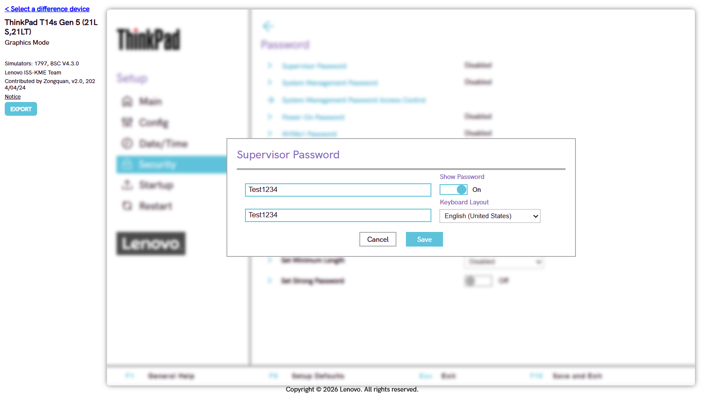
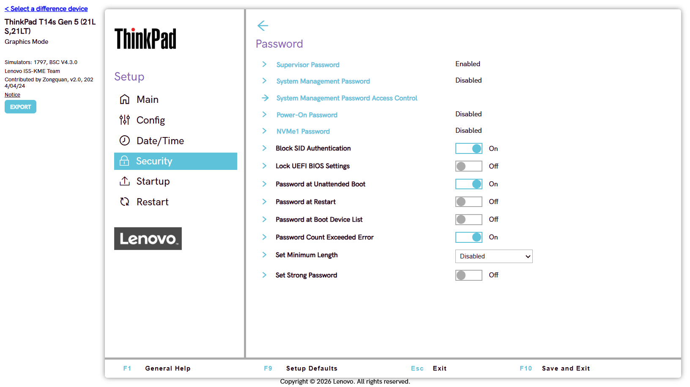
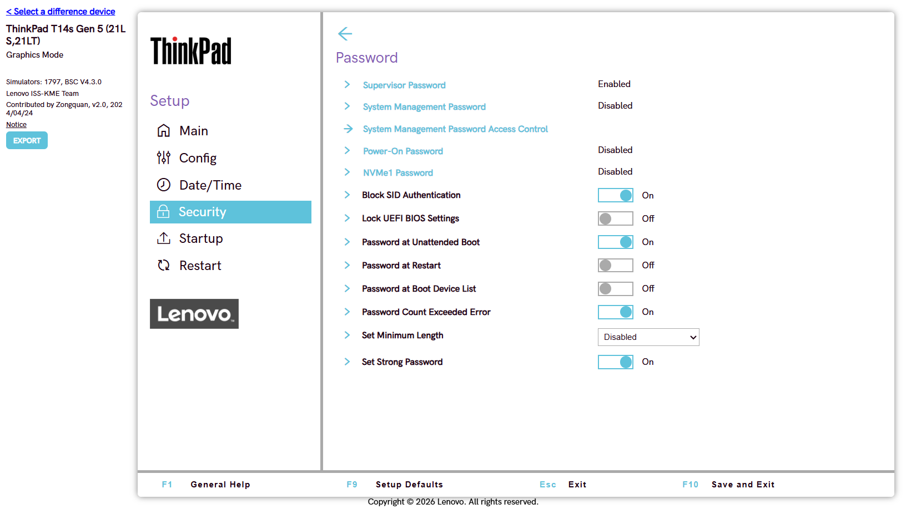
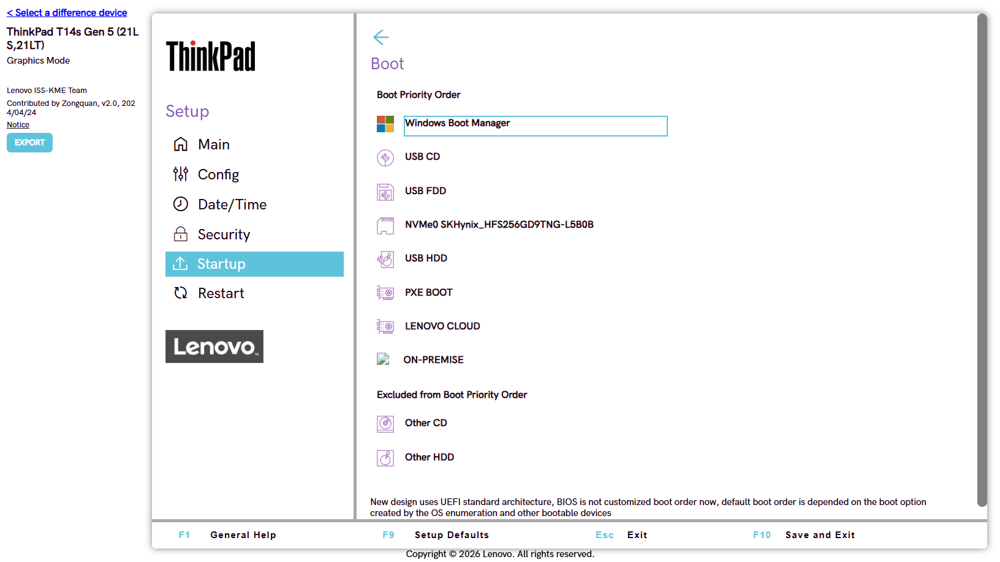
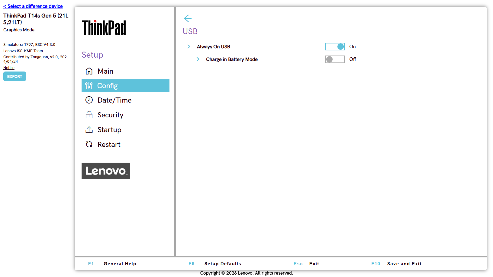

# BIOS/UEFI. Lenovo BIOS Simulator

Симулятор: https://download.lenovo.com/bsco/index.html

Модель: ThinkPad T14s Gen 5 (21LS, 21LT), режим Graphics Interface Mode.

Справка открывается клавишей F1. F9 сбрасывает настройки, F10 сохраняет их и закрывает Setup, Esc возвращает на предыдущий экран, Enter открывает выбранный пункт. В справке для смены порядка загрузки указаны F5 и F6. В графическом режиме список у меня сдвинулся перетаскиванием пунктов.

## Задача 1. Разделы Setup

В левом меню шесть разделов: Main, Config, Date/Time, Security, Startup и Restart.

В Main собраны сведения о компьютере. Эти поля только для просмотра.

Из задания нужно было записать следующее.

- Серийный номер устройства: PF12345. Серийный номер платы: L112345678.
- Версия UEFI: N46ET09W, дата 2024-01-22.
- Процессор: Intel Core. Частота в симуляторе указана как 1.X00GHz.

Там же указаны 8192 МБ памяти. Secure Boot уже включён. В строке BIOS Event log написано Simulator not support.

В Config находятся настройки оборудования: сеть, USB, клавиатура и мышь, экран, питание, звуковые сигналы, процессор, Thunderbolt и Intel AMT.

В Security находятся пароли, Secure Boot и остальные параметры защиты.

В Startup настраивается загрузка.

В Restart сохраняют изменения, выходят из Setup или возвращают заводские значения.

## Задача 2. Порядок загрузки

Путь: Startup → Boot.

Исходный порядок:

1. Windows Boot Manager
2. USB CD
3. USB FDD
4. NVMe0 SKHynix_HFS256GD9TNG-L5B0B
5. USB HDD
6. PXE BOOT
7. LENOVO CLOUD
8. ON-PREMISE

Other CD и Other HDD находятся ниже, в разделе Excluded from Boot Priority Order. Из этих устройств система не загружается.

Клавиши F5 и F6 этот список не сдвинули. В графическом режиме устройства перетаскиваются мышью. В качестве USB взял USB HDD, потому что с флешки обычно ставят систему. Поставил её первой, а диск NVMe — второй.

1. USB HDD
2. NVMe0
3. Windows Boot Manager
4. USB CD
5. USB FDD
6. PXE BOOT
7. LENOVO CLOUD
8. ON-PREMISE

Этот порядок сохраняется, пока открыт Setup. Чтобы записать его, нужно нажать F10.

## Задача 3. Secure Boot

Путь: Security → Secure Boot.

Изначально параметр был включён: On, режим User Mode, состояние ключей Standard Mode.

Я выключил Secure Boot, а затем снова включил. Отдельного сообщения о перезагрузке не появилось: переключатель меняет значение сразу.

Secure Boot при старте проверяет подпись загрузчика. Если доверенной подписи нет, система не запускается. Поэтому с произвольной флешки загрузиться сложнее. Параметр отключают, когда нужно установить систему, которую эта проверка не пропускает.

На реальном ноутбуке изменение применяется после сохранения через F10 и перезагрузки. В симуляторе пункт просто переключился.

## Задача 4. Пароль супервизора

Путь: Security → Password → Supervisor Password.

Сначала статус был Disabled. Я ввёл Test1234 в оба поля и нажал Save.

Статус сменился на Enabled.

После этого я изменил параметр Set Strong Password. По заданию Setup должен был запросить пароль супервизора. Запроса не было: параметр сразу переключился в On.

Снять пароль в том же окне не получилось. Пустой пароль симулятор не принимает, а поля для текущего пароля нет. На реальном ThinkPad пароль снимают так: вводят текущий пароль и оставляют новый пустым. В симуляторе этого шага нет. Статус снова стал Disabled только после заводского сброса. На реальном компьютере такой сброс пароль супервизора обычно не удаляет.

## Задача 5. Заводские настройки

Путь: Restart → Load Factory Defaults. Та же операция назначена на F9. В справке она называется Setup Defaults.

Появился вопрос: Load the BIOS factory default configuration now?

Я нажал Yes. Страница симулятора перезагрузилась, и настройки вернулись к исходным.

В подсказке к этому пункту написано, что параметры Security и дата со временем не сбрасываются. В симуляторе сбросились и они. Пароль супервизора снова Disabled, первым в загрузке снова стоит Windows Boot Manager, Secure Boot включён, Boot Mode равен Quick, Always On USB включён.

## Задача 6. USB

Пункта USB BIOS Support у этой модели нет. Нужный параметр называется Always On USB и находится по пути Config → USB → Always On USB.

Он управляет питанием USB-портов, когда ноутбук выключен или находится в режиме сна и подключён к зарядке. В положении On порты продолжают питать подключённое устройство. В положении Off питание в этих состояниях отключается.

Изначально параметр был включён. Я выключил его, а затем включил обратно.

Пока Always On USB выключен, с экрана пропадает пункт Charge in Battery Mode. Он отвечает за зарядку от батареи в выключенном состоянии и отображается только вместе с питанием портов.

## Задача 7. Режим диска

Пунктов Config → Storage и SATA Controller Mode в этом Setup нет. Отдельного раздела для накопителя в Config тоже нет. Диск виден только в списке загрузки: NVMe0 SKHynix_HFS256GD9TNG-L5B0B. Переключить AHCI, RAID или Intel RST здесь нельзя, поэтому предупреждение о смене режима не появлялось. У ThinkPad T14s Gen 5 нет обычного SATA-диска: установлен накопитель NVMe.

На компьютерах, где такой пункт есть, обычно доступны следующие режимы. AHCI показывает каждый диск отдельно, и Windows с Linux ставятся без дополнительного драйвера. RAID и Intel RST используют, когда диски собраны в массив или подключён кэш Intel. Без драйвера RST установщик часто не видит такой диск. На новых платах похожую роль выполняет Intel VMD: накопитель NVMe скрыт за контроллером, и установщик показывает его только после установки драйвера.

Если сменить режим на компьютере с уже установленной системой, она может не найти загрузочный диск. Перед сменой режима нужна резервная копия.

## Задача 8. Меню загрузки F12

Постоянный порядок загрузки задаётся в Startup → Boot и сохраняется в настройках.

Отдельный параметр называется Startup → Boot device List F12 Option. Сейчас он включён. Если параметр включён, клавиша F12 при старте открывает список устройств на одну загрузку. Выбранное устройство используется только в этот раз, а сохранённый порядок не меняется.

Рядом находится Boot Mode со значениями Quick и Diagnostics. В режиме Quick проверка при старте не показывается, пока не нажата клавиша Esc. В режиме Diagnostics эта проверка выводится при каждой загрузке. Я переключил режим на Diagnostics, а затем вернул Quick.

Чтобы один раз загрузиться с флешки, достаточно меню F12. Постоянный порядок в разделе Boot для этого менять не требуется.

## Задача 9. Журнал событий

Внизу раздела Main есть строка BIOS Event log. В ней написано Simulator not support. Раздела Config → Diagnostics в этом Setup нет, пункта Clear Event Log тоже нет. Просмотреть журнал и очистить его в симуляторе нельзя.

На реальном ThinkPad журнал находится в разделе Main или в отдельном пункте BIOS Event Log. Туда записываются ошибки самопроверки, сбои памяти и неудачные загрузки. Очистка выполняется пунктом Clear Event Log в том же разделе.

Экран Main приведён в задаче 1.

## Задача 10. Подготовка к переустановке системы

После заводского сброса я повторил сценарий целиком.

1. Открыл Restart → Load Factory Defaults и нажал Yes. Настройки стали исходными.
2. Проверил Secure Boot. Он уже был включён, и я оставил его в этом состоянии. Для обычной установки Windows параметр должен быть включён.
3. Установил пароль супервизора Test1234. Статус стал Enabled.
4. В разделе Boot поставил USB HDD на первое место, а NVMe на второе. Этот порядок показан в задаче 2.
5. Нажал F10. Появился вопрос Save configuration changes and exit now?

Кнопка Yes в симуляторе не записывает настройки в компьютер. Симулятор предлагает скачать файл с изменениями и возвращает к выбору устройства. При следующем входе снова открываются заводские настройки, поэтому я проверил результат, не нажимая Yes.

6. Снова открыл Security → Password. Пароль супервизора оставался в состоянии Enabled. Порядок загрузки тоже сохранился: сначала USB HDD, затем NVMe.

После этого я ещё раз выполнил Load Factory Defaults. Пароль супервизора стал Disabled, а первым устройством загрузки снова оказался Windows Boot Manager. Эти экраны показаны в задаче 5.

В симуляторе пароль и порядок загрузки по отдельности не возвращаются. Их возвращает только общий заводской сброс.
