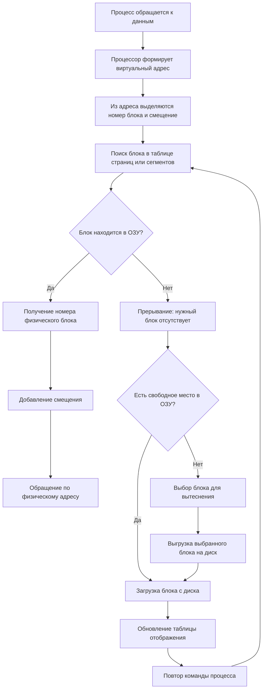

# Путь работы виртуальной памяти

## 1. Зачем нужна виртуальная память

Оперативная память ограничена, а запущенным процессам может требоваться больше памяти, чем физически установлено в компьютере. Виртуальная память позволяет:

- выполнять программы, размер которых превышает объём свободной ОЗУ;
- представлять каждому процессу собственное непрерывное адресное пространство;
- хранить в ОЗУ только используемые части программы;
- временно размещать остальные части на диске;
- изолировать память разных процессов.

Программа работает так, как будто целиком находится в оперативной памяти. Перемещением данных и преобразованием адресов управляют операционная система и аппаратные средства.

## 2. Уровни адресов

Путь к данным начинается с формирования адреса:

1. **Символьный адрес** задаётся программистом: например, имя переменной.
2. **Виртуальный адрес** формируется транслятором. Он не зависит от фактического размещения программы в ОЗУ.
3. **Физический адрес** указывает реальную ячейку оперативной памяти.

Соответствие виртуальных и физических адресов устанавливает механизм **динамического преобразования адресов (ДПА)**.

## 3. Общая схема работы



## 4. Пошаговый путь обращения к памяти

### Шаг 1. Формирование виртуального адреса

Выполняемая команда обращается не напрямую к физической памяти, а к виртуальному адресу. Обычно он состоит из:

- номера страницы или сегмента;
- смещения внутри выбранного блока.

Для сегментно-страничной организации используются три компонента: номер сегмента, номер страницы и смещение.

### Шаг 2. Обращение к таблице отображения

Операционная система создаёт для каждого процесса собственную таблицу страниц или сегментов. При активизации процесса адрес этой таблицы загружается в специальный регистр процессора.

В записи таблицы могут храниться:

- номер соответствующей физической страницы;
- бит присутствия блока в ОЗУ;
- признак изменения страницы;
- признак обращения;
- запрет на выгрузку;
- сведения о размещении блока на диске.

### Шаг 3. Проверка присутствия

Если бит присутствия равен `1`, блок уже находится в оперативной памяти. Из таблицы берётся номер физического блока, к его начальному адресу прибавляется смещение — получается физический адрес.

Если бит присутствия равен `0`, нужная часть процесса находится на диске. Возникает прерывание, после которого управление получает операционная система.

### Шаг 4. Поиск места в ОЗУ

ОС проверяет, есть ли свободная физическая страница или подходящий участок памяти:

- если место есть, нужный блок загружается с диска;
- если память заполнена, ОС выбирает блок для вытеснения.

### Шаг 5. Выбор блока для замещения

В презентации перечислены следующие стратегии:

- **случайная** — вытесняется случайный блок;
- **FIFO** — вытесняется блок, загруженный раньше остальных;
- **LRU** — вытесняется блок, который дольше всего не использовался;
- **LFU** — вытесняется блок с наименьшим числом обращений;
- **NUR** — вытесняется блок, не использовавшийся в последнее время.

Если выбранная страница была изменена, перед освобождением места её содержимое необходимо сохранить на диске.

### Шаг 6. Подкачка нужного блока

Нужная страница или сегмент загружается из внешней памяти в свободную область ОЗУ. Затем операционная система:

1. обновляет таблицу отображения;
2. устанавливает бит присутствия;
3. записывает номер физического блока;
4. повторяет прерванную команду процесса.

При повторном обращении адрес успешно преобразуется, и процесс получает необходимые данные.

## 5. Способы организации виртуальной памяти

### Страничная организация

- Виртуальное пространство делится на блоки одинакового размера — страницы.
- ОЗУ делится на физические страницы такого же размера.
- Виртуальный адрес имеет вид `(номер страницы, смещение)`.
- Отображение хранится в таблице страниц.
- Страницу можно разместить в любой свободной физической странице.

### Сегментная организация

- Программа делится на логические части переменного размера — сегменты.
- Виртуальный адрес имеет вид `(номер сегмента, смещение)`.
- Дескриптор содержит начальный физический адрес, длину сегмента и права доступа.
- Физический адрес получается сложением начального адреса сегмента и смещения.
- Недостатками являются фрагментация и более сложное преобразование адресов.

### Сегментно-страничная организация

- Адресное пространство сначала делится на сегменты.
- Каждый сегмент дополнительно делится на страницы.
- Виртуальный адрес состоит из номера сегмента, номера страницы и смещения.
- Загрузка выполняется постранично.

### Двухуровневая страничная организация

Таблица страниц разбивается на уровни. Это уменьшает объём памяти, необходимый для хранения таблиц больших виртуальных адресных пространств.

## 6. Свопинг и виртуальная память

Эти механизмы отличаются объёмом перемещаемых данных:

- **свопинг** перемещает между ОЗУ и диском образ процесса целиком;
- **виртуальная память** перемещает только необходимые части процесса — страницы или сегменты.

Виртуальная память обычно эффективнее, поскольку программе не требуется полностью находиться в ОЗУ.

## 7. Стратегии управления

Операционная система решает три основные задачи:

1. **Стратегия выборки** — когда загружать блок:
   - по запросу;
   - заранее, с учётом последовательности выполнения и локальности.
2. **Стратегия размещения** — куда поместить блок:
   - первый подходящий участок;
   - наиболее подходящий участок;
   - наименее подходящий участок.
3. **Стратегия замещения** — какой блок удалить при заполненной памяти.

## 8. Защита памяти

Каждый процесс получает отдельное виртуальное адресное пространство. Таблицы отображения и права доступа не позволяют процессу произвольно читать или изменять память другого процесса. При сегментной организации дополнительно проверяются границы сегмента и разрешённый тип доступа.

## 9. Краткий итоговый маршрут

```text
Символьный адрес
→ виртуальный адрес
→ номер страницы/сегмента и смещение
→ таблица отображения
→ проверка присутствия
→ при необходимости вытеснение другого блока
→ загрузка нужного блока с диска
→ обновление таблицы
→ получение физического адреса
→ доступ к данным в оперативной памяти
```

Таким образом, виртуальная память отделяет адресное пространство процесса от реальной ОЗУ. Процесс видит непрерывную память большого объёма, а операционная система динамически размещает её части между оперативной и внешней памятью.
